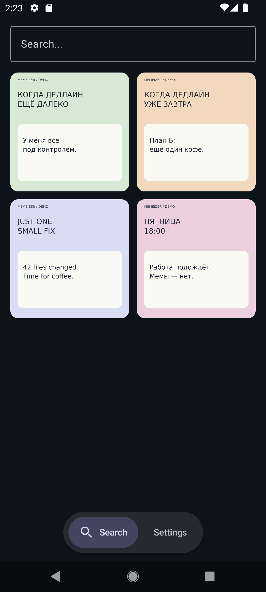
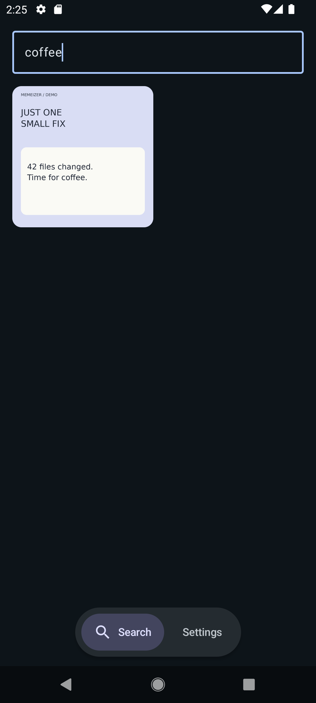
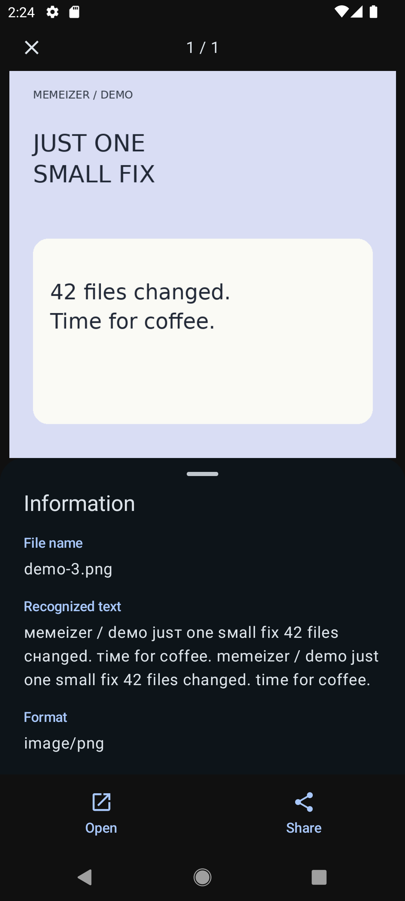

<div align="center">
  
  <h1>Memeizer</h1>
  <p><strong>Remember the words. Find the meme.</strong></p>
  <p>A native Android app that searches your saved memes by the text inside them.<br>Text recognition and search happen entirely on your device.</p>
  <p><strong>Android 12+</strong> · <strong>Russian & English OCR</strong> · <strong>No account required</strong></p>
  <p><a href="https://github.com/Hedgezi/memeizer/releases">Releases</a> · <a href="#getting-started">Getting started</a> · <a href="docs/DEVELOPMENT.md">Developer guide</a></p>
</div>

## Your meme collection, searchable

You saved the perfect reaction somewhere among hundreds of pictures. The filename tells you nothing, but you remember a few words from the caption.

Memeizer turns those words into a way to find it. Choose your meme folders once, let the app recognize their text, then search your collection without manually naming files or adding tags.

## See it in action

<table>
  <tr>
    <th>Browse your collection</th>
    <th>Search the words</th>
    <th>Inspect the result</th>
  </tr>
  <tr>
    <td></td>
    <td></td>
    <td></td>
  </tr>
</table>

Actual app screenshots captured on Android 12 using purpose-made demo images. The search example uses **“coffee”**: the app finds the caption even though the file is named `demo-3.png`. The interface is available in English and Russian.

## What you can do

- **Search text inside images.** Recognize Russian and English captions, search regardless of capitalization, and match words by their first letters.
- **Bring your own folders.** Add one or more folders through Android’s file picker. Browse JPEG, PNG, and WebP images together by leaving the search field empty.
- **Take a closer look.** Open images in a full-screen viewer, swipe between results, zoom in, and inspect recognized text and file details.
- **Share what you find.** Send a meme through Android’s share menu or open it in another app.
- **Keep the collection current.** Index images after adding a folder, refresh manually, or let background checks run while the device is idle and charging.

## Getting started

1. Open **Settings → Folders** and select **Add folder**.
2. Choose a folder with images and allow access. Wait for the initial text recognition to finish; larger collections take longer.
3. Go to **Search** and type a word from a caption. Leave the field empty to browse the gallery.
4. Tap a result to view it, inspect its text, or share it.

Published builds are available through [GitHub Releases](https://github.com/Hedgezi/memeizer/releases). The app requires **Android 12 or later**, with builds targeting `arm64-v8a` and `x86_64`. To build from source, see [For developers](#for-developers).

## Private by design

Memeizer only processes folders you explicitly select. Text recognition, the search index, and queries stay on the device; these features require no account, server, or cloud upload. Sharing an image with another app is an explicit user action.

## Engineering behind the experience

This project brings together a native Android interface, on-device text recognition, and local search in a complete workflow—from choosing a folder to sharing a matching image.

| Challenge | Implementation |
| --- | --- |
| An interactive image viewer | Kotlin, Jetpack Compose, and Material 3; gestures for zooming, paging, and revealing image information |
| Reading two writing systems | PaddleOCR through NCNN and C++/JNI for Cyrillic; Google ML Kit for Latin text |
| Searching a local collection | Room FTS for recognized words; separate CLIP embeddings and exact cosine top-30 for English descriptions |
| User-controlled file access | Android’s Storage Access Framework, persistent folder access, and overlapping-folder detection |
| Updating without repeating all OCR | WorkManager, incremental indexing, and reuse of cached recognition results |
| Keeping responsibilities separate | Screen state in ViewModels, data operations in repositories, Coroutines and Flow for asynchronous updates |
| Checking behavior | JVM and Android tests for gallery states, indexing, folder handling, and viewer gestures; a local `tools/backend` diagnostic CLI |

## Current scope

The source currently declares version **0.2.0**. The project is under active development.

Search offers **By text** for recognized Cyrillic/Latin words and **By meaning** for
English descriptions of a scene. Semantic search runs offline with bundled TinyCLIP
encoders and returns up to **30** nearest images, including images without captions.
The gallery and text search show up to **100** images per view. Both indexes update
automatically; semantic results can be partial while the CLIP index is building.

TinyCLIP FP32 is the accepted current model as of 2026-10-11. A small local retrieval
check passed; broader comparative quality and target flagship performance remain
unmeasured. Model replacement or a model picker is deferred until actual usage shows
a need. See the [decision and research results](docs/CLIP_MODEL_DECISION.md) and the
[model guide](tools/clip/README.md).

## For developers

Use **JDK 17**, Android SDK platforms **35** and **33**, NDK **29.0.14206865**, and CMake. Configure your SDK path in an untracked `local.properties` file and select JDK 17 as Android Studio’s Gradle JDK.

First [prepare the bundled CLIP assets](tools/clip/README.md#reproduce-the-assets).
The large ONNX files are generated locally and included in the APK.

From the repository root, with JDK 17 selected in your terminal:

```bash
./gradlew assembleDebug
./gradlew :app:installDebug
```

The debug APK is written to `app/build/outputs/apk/debug/app-debug.apk`.

```bash
./gradlew :app:testDebugUnitTest :app:lintDebug
# Requires a connected Android device or emulator:
./gradlew :app:connectedDebugAndroidTest
```

The [developer guide](docs/DEVELOPMENT.md) covers build configuration, project structure, OCR internals, release signing, and local index diagnostics.

See [third-party notices](THIRD_PARTY_NOTICES.md) for the OCR models, libraries, and their licenses.
